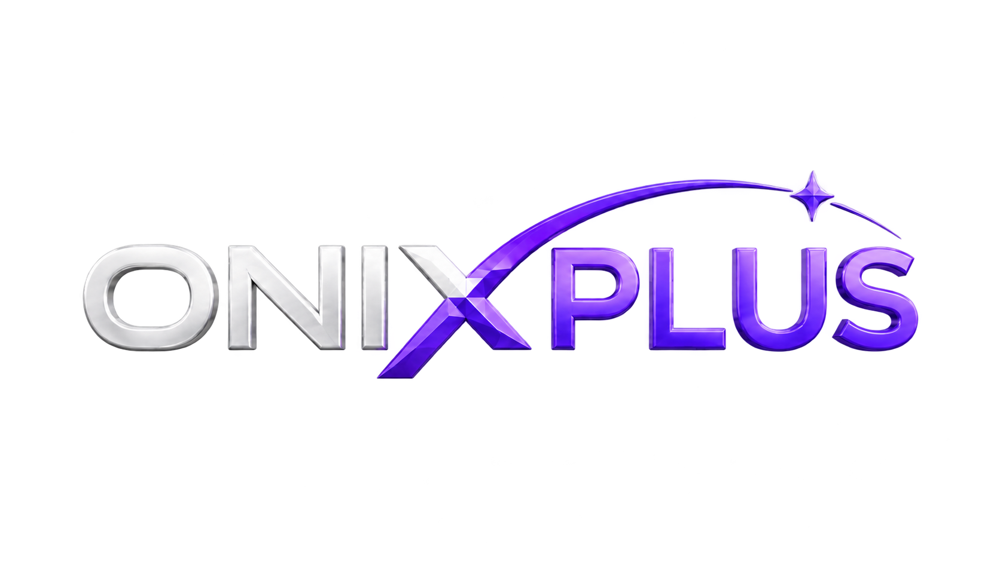

# ONIXPLUS



ONIXPLUS is a product fork of [IPTVnator](https://github.com/4gray/iptvnator), focused on becoming a modern, local-first IPTV player for sources supplied by the user.

The project plays and organizes compatible M3U/M3U8, Xtream Codes, Stalker/Ministra, XMLTV/EPG, live TV, VOD, and series sources. It does not provide playlists, subscriptions, channels, credentials, or copyrighted content.

> [!IMPORTANT]
> The ONIXPLUS name, logo, icon, palette, application ID, updater, and repository metadata are implemented. Public release remains blocked by the security, signing, native-build, and PWA privacy decisions documented below.

## Project Status

- Audited upstream revision: `df8962969e1fa167afdf68c7f1ac05d7f2357556`.
- Current phase: ONIXPLUS branding and release-readiness validation.
- Public product name: ONIXPLUS.
- Primary development/release target: Windows desktop.
- Framework baseline: Angular + Electron + Nx.
- Cost principle: local and open-source first; initial infrastructure cost R$ 0.
- Telemetry: none by default.

The frontend, local web backend, and Electron native dependency rebuild have been validated on Windows. A short path outside OneDrive remains recommended for reliable packaging; see [Setup](./docs/SETUP.md).

## Existing Capabilities

The fork inherits a mature implementation that includes:

- M3U/M3U8 import from URL, file, or raw text, with custom headers and refresh;
- Xtream Codes and Stalker/Ministra portals;
- live TV, radio, VOD, series, EPG/XMLTV, catch-up, favorites, and history;
- HTML5/hls.js, Video.js, ArtPlayer, Shaka/DASH, mpegts.js, MPV, and VLC playback paths;
- SQLite/Drizzle persistence in Electron and IndexedDB in the browser;
- Electron workers for database, playlist refresh, and EPG processing;
- desktop and installable PWA runtimes;
- unit, integration, E2E, packaging, and performance infrastructure.

The preservation checklist is maintained in [Existing Features](./docs/EXISTING-FEATURES.md).

## Quick Start — Web Development

Requirements:

- Node `^22.13.0` or `>=24.0.0`;
- pnpm `10.33.0` through Corepack;
- two PowerShell terminals.

Install once:

```powershell
corepack prepare pnpm@10.33.0 --activate
corepack pnpm install --frozen-lockfile
corepack pnpm nx show projects
```

Terminal 1 — local backend expected by the development frontend:

```powershell
$env:PORT='3000'
$env:CLIENT_URL='http://localhost:4200'
$env:IPTVNATOR_PROXY_ALLOW_PRIVATE_NETWORKS='1'
$env:TSX_TSCONFIG_PATH='tsconfig.base.json'
corepack pnpm exec tsx apps/web-backend/src/main.ts
```

Terminal 2 — Angular frontend:

```powershell
corepack pnpm run serve:frontend
```

Open <http://localhost:4200>. Confirm the backend at <http://localhost:3000/health> before testing remote M3U, Xtream, or Stalker imports.

For the complete Windows, Electron, PWA, and troubleshooting instructions, read [Setup](./docs/SETUP.md) and [Development](./docs/DEVELOPMENT.md).

## Validation

Start with the documented validation ladder:

```powershell
corepack pnpm run deps:nx:validate
corepack pnpm run deps:vite:test
corepack pnpm run styles:inputs:validate
corepack pnpm run typecheck:ci
corepack pnpm run i18n:check
corepack pnpm run lint
corepack pnpm run test:unit:ci
```

Build and E2E commands, prerequisites, and manual checks are in [Testing](./docs/TESTING.md).

## Architecture

ONIXPLUS preserves the existing Nx domain boundaries and evolves them incrementally:

```text
Angular renderer / PWA
  -> provider-specific state and data access
  -> shared catalog and playback contracts
  -> Electron preload/IPC/main/SQLite or PWA backend/IndexedDB
```

Do not create a parallel provider implementation. ONIXPLUS facades should delegate to the existing M3U, Xtream, and Stalker domains.

Key documents:

- [Technical Audit](./docs/ONIXPLUS-TECHNICAL-AUDIT.md)
- [Architecture](./docs/ARCHITECTURE.md)
- [Architecture Decisions](./docs/DECISIONS.md)
- [Branding Migration](./docs/BRANDING.md)
- [Development](./docs/DEVELOPMENT.md)
- [Testing](./docs/TESTING.md)
- [Changelog](./docs/CHANGELOG.md)

## Git Model

The original project is retained as the `upstream` remote. The ONIXPLUS repository is configured as `origin`:

```powershell
git remote -v
git remote get-url origin
git fetch upstream
git push -u origin <branch>
```

Expected origin: `https://github.com/Nicolaslima26/NICKTV.git`. Use `codex/` as the default prefix for agent-created branches in this workspace.

## Security and Privacy

- Never commit or log IPTV URLs, usernames, passwords, MAC addresses, tokens, or real provider fixtures.
- Use test/mock sources for development, screenshots, and E2E.
- Electron should connect directly to providers where possible.
- The browser runtime requires a backend to avoid CORS; a shared production intermediary has not been approved for ONIXPLUS.
- Upstream playlist records currently persist provider secrets in plaintext. Secure credential storage is a release blocker documented in [ADR-004](./docs/DECISIONS.md#adr-004--protect-provider-credentials-before-public-distribution).

## License and Upstream Attribution

The source is provided under the [MIT License](./LICENSE.md). ONIXPLUS is based on IPTVnator by 4gray and retains the upstream copyright and license notice.

The IPTVnator name and logo are not covered by the MIT software license. They remain trademarks of the upstream project as described in [TRADEMARK.md](./TRADEMARK.md). ONIXPLUS uses separate name, icons, artwork, application identifiers, and release channels.

ONIXPLUS is not affiliated with or endorsed by the IPTVnator project.

## Disclaimer

ONIXPLUS is a media player for user-supplied, authorized sources. Users are responsible for ensuring they have permission to access and play any configured content. The project does not sell, host, curate, or distribute IPTV services or media.
